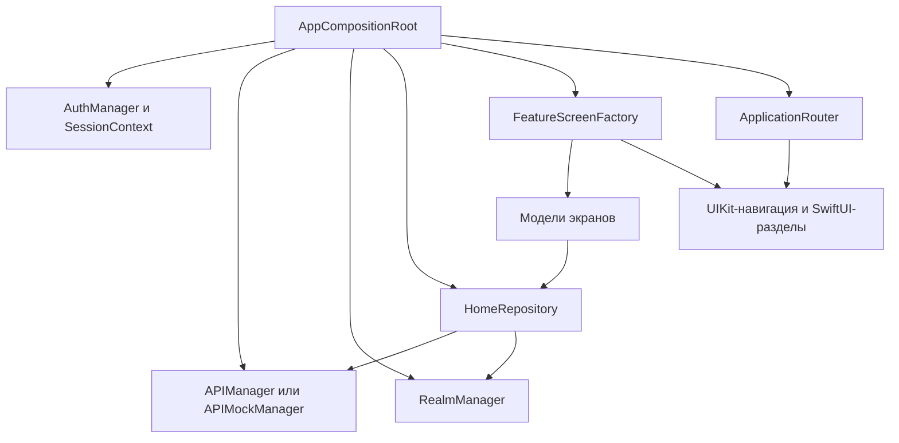

# Архитектура Qase Mobile

UIKit отвечает за навигацию и формы, SwiftUI — за Home/Repository/Work/Settings, SnapKit — за UIKit-компоновку. Зависимости передаются явно. Realm — текущий локальный кеш; переход на SwiftData описан в [roadmap](ROADMAP.md).

## Сборка приложения и навигация

1. `AppDelegate` создаёт [AppCompositionRoot](../QaseAPIProj/Classes/AppCompositionRoot.swift). `SceneDelegate` получает root и настройки окна.
2. Composition root создаёт `SessionContext`, настройки, credential storage, реальные и mock-сетевые зависимости и Realm. `RootViewController` показывает авторизацию либо основные разделы.
3. После входа создаются `HomeRepository`, выбор проекта, координатор черновиков, каталог наборов, `FeatureScreenFactory`, `ApplicationRouter` и контейнер вкладок.
4. Router получает UI-host после сборки; factory передаёт экранам готовые модели и узкие contracts. После смены токена граф пересоздаётся; при выходе освобождается.

## Сессия и авторизация

[SessionContext](../QaseAPIProj/Data/SessionContext.swift) хранит владельца и поколение сессии. Захваченный `SessionStamp` сравнивается с текущим состоянием перед публикацией результата и записью кеша. Выход или замена credentials инвалидируют старую сессию; прежние модели не обслуживают новую.

[AuthManager](../QaseAPIProj/Data/AuthManager.swift) получает credential storage. В обычном окружении используется Keychain, в UI-тестах — память. Credentials содержат токен и локальный идентификатор владельца; он не является ID пользователя Qase. Проверка кандидата токена предшествует его сохранению и не меняет текущую сессию при отказе. Ошибка записи/удаления credentials сохраняет исходную авторизацию.

`APIManager.auth(by:)` возвращает `false` для HTTP 401; прочие HTTP-отказы и транспортные ошибки передаются через существующую классификацию. Сетевые сообщения не выводятся напрямую, если могут раскрыть секрет. Экран авторизации блокирует повторное действие, отменяет запрос при удалении контроллера и игнорирует запоздавший ответ.

Демо использует `APIMockManager` с JSON fixtures и отдельный Realm store. UI-тесты создают изолированное окружение. Production-кеш и реальные запросы не используются в этих сценариях.

## Сеть и загрузка

[APIManager](../QaseAPIProj/Data/APIManager.swift) формирует запросы `API.Operation` и получает `HTTPTransport`. Источник credentials читается при создании каждого JSON/multipart запроса; проверка кандидата использует явно переданный токен. [Каталог API](API_V1.md) перечисляет сетевые операции, не обещая экраны для каждой из них.

[HomeRepository](../QaseAPIProj/Data/HomeRepository.swift) загружает проекты, кейсы, наборы, запуски и дефекты, согласует результаты с кешем и проверяет сессию после ожидания сети. Модели управляют загрузкой, ошибками, кешированными данными и пагинацией; индикаторы загрузки принадлежат экранам.

`PaginationPolicy` задаёт размер страницы 50. При отсутствии `total` полная страница не считается концом списка. [SuiteCatalogLoader](../QaseAPIProj/Data/SuiteCatalogLoader.swift) читает полный каталог, учитывает отмену и поколение запроса; повторяющаяся страница не подтверждает полноту. Поиск использует debounce из `SearchPolicy`.

## Кеш и offline-поведение

[RealmManager](../QaseAPIProj/Data/Database/RealmDB.swift) использует schema 5. Ключи связывают данные с владельцем, проектом и типом сущности. Корень иерархии представлен `nil`, а не глобальным текущим проектом.

- Полный каталог наборов и его маркер полноты записываются одной транзакцией.
- Полный список кейсов и снимок уровня репозитория также сохраняются атомарно.
- Поиск и частичные страницы не заменяют весь каталог и не удаляют другие кешированные записи.
- Между проверкой session stamp и записью нет `await`; инвалидирование и запись согласованы на одном actor.
- Ошибка кеширования не блокирует показ свежих сетевых данных и сообщается отдельно.
- Очистка загруженных данных из Settings сохраняет авторизацию, выбранный проект и историю просмотров. Полная очистка при смене сессии — отдельная операция.

Кеш помогает читать ранее загруженные данные. Персистентная очередь offline-изменений и их синхронизация ещё не реализованы.

## Формы и черновики

[EntityCreationViewModel](../QaseAPIProj/ViewModel/EntityCreationViewModel.swift) хранит два независимых черновика — набора и кейса. Переключение типа сохраняет ввод; выбор родителя меняет только активный тип. Обычная кнопка создаёт активную сущность, координатор может сохранять изменённые черновики последовательно при уходе.

Название проверяется после удаления внешних пробелов. Во время сохранения повторный запрос и уход блокируются. Ошибка сохраняет ввод; подтверждённый снимок успешной части становится baseline и не отправляется повторно после частичного сбоя.

[TestCaseEditorViewModel](../QaseAPIProj/ViewModel/TestCaseEditorViewModel.swift) управляет единым редактором. Все параметры доступны в одной форме, шаги read-only; неизменённые серверные поля, вложения, теги и родитель сохраняются в payload. Перенос кейса между наборами через редактор и отдельный редактор набора ещё не входят в текущий интерфейс.

Загрузка редактора отменяется при уходе и инвалидировании сессии; поздний ответ не публикуется, не записывается в кеш или историю. Back, жест, закрытие, смена вкладки/проекта и токена проходят защиту черновиков. Формы создания набора/кейса и редактирования кейса используют grouped-оформление; создание проекта сохраняет standard.

## Общие ресурсы и проверки

- `AppTheme` — цвета, типографика и общие размеры; `Layout` — геометрия конкретного компонента.
- `AppPolicies` — пагинация, поиск и кеш; `AppImages` — каталог изображений и symbols.
- `AccessibilityID` — общий Foundation-only исходник app и UI-tests; динамические ключи формируются в каталоге.
- `Localizable.xcstrings` — русский и английский интерфейс.
- SPM-зависимости заданы в `project.pbxproj`, ревизии сохранены в `Package.resolved`.

В проекте есть исходники регрессионных проверок сессии, заголовков токена, Codable/Realm, кеша, черновиков, геометрии и доступности. Их наличие не подтверждает прохождение. [Проверки и ограничения](DEVELOPMENT.md) выполняет пользователь; [дизайн-система](../Design/DESIGN_SYSTEM.md) описывает визуальные контракты.
